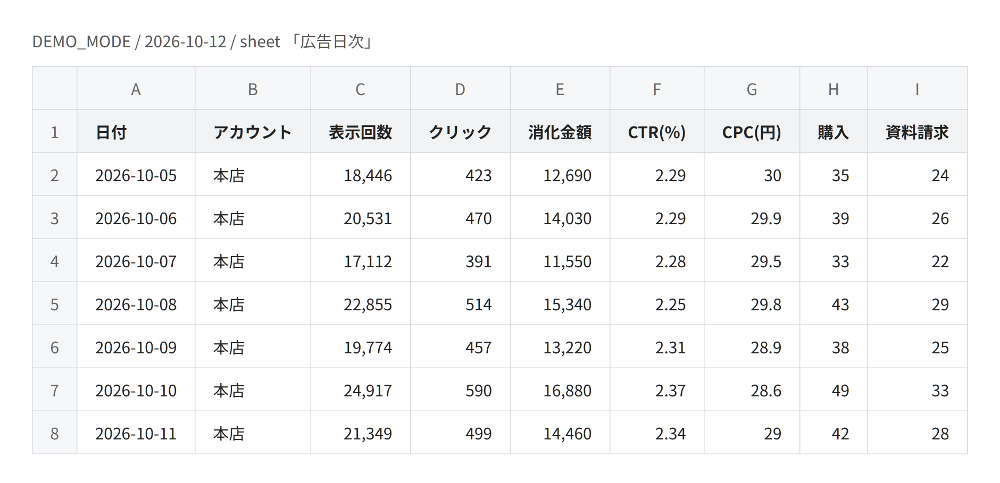

# meta-ads-daily-report

[](https://github.com/Mxhlix/meta-ads-daily-report/actions/workflows/test.yml)

English | [日本語](#日本語)

A Google Apps Script that fetches daily Meta ads numbers through the Graph API and writes them to a Google Sheets spreadsheet, one row per day.



The image is a table drawn from [docs/demo-run.json](docs/demo-run.json), which is what `node test/demo-run.js` saved after running `Code.gs` once with its default settings (demo mode, no network). The numbers are the fixed sample numbers of demo mode, not real ad data. It was not captured from Google Sheets.

## What it does

- For up to 3 ad accounts, fetches impressions, clicks, spend and conversions per day, and writes them to the 「広告日次」 (daily) sheet.
- Calculates CTR and CPC from clicks, impressions and spend.
- Conversions can be Meta standard events (such as purchase or lead) or custom conversions. Each one becomes its own column.
- Optional: per-campaign and per-ad-set sheets.
- Optional: weekly (Monday start) and monthly summary sheets built from the daily sheet.
- Optional: emails the latest weekly or monthly summary.
- Creates time-driven triggers: a daily update, and a weekly (Monday) and monthly (1st) mail when mail and the matching summary are on.
- A demo mode fills the sheets with fixed sample numbers without any network access or token.

## Design notes

- It fetches up to yesterday. Today's numbers are partial, so they are not fetched. Each run goes back `LOOKBACK_DAYS` days (3 by default) and fetches them again, because recent numbers can still change.
- No duplicate rows. Rows are matched by date and account (plus the campaign or ad set name on the breakdown sheets). A matching row is overwritten and a new one is appended. Running it again does not add rows.
- Errors are not swallowed. A missing token, an API error, a response that is not JSON, or an HTTP status other than 200 throws an exception, so the run ends as failed instead of looking successful.
- Settings are checked before anything runs. An empty account list, more than 3 accounts, an ID that does not start with `act_`, or a broken conversion setting stops the run with a message.
- Mail requires a summary. Mail sends summary results, so turning mail on with both weekly and monthly summaries off is treated as a setting error. Both the daily update and trigger creation stop with a message, so it never stays silent while sending nothing.
- The access token can be kept in the script property `META_TOKEN` instead of in the code. The code uses `CONFIG.ACCESS_TOKEN` only when it is filled in.
- Summary CTR and CPC are recalculated from the summed clicks, impressions and spend. They are not an average of daily rates.
- Standard events are matched by the exact `action_type` string. Custom conversions are matched when the `action_type` contains the conversion ID.
- When there are no impressions or clicks, CTR and CPC are 0 instead of dividing by zero.
- If the conversion settings change the columns, only the header row is replaced. Existing data stays.
- Trigger hours come from `CONFIG.SCHEDULE`. Apps Script runs an hourly trigger somewhere within that hour, so minutes cannot be set.

## Verification

GAS does not run locally, so `test/run-tests.js` imitates the GAS features it uses (spreadsheets, script properties, URL fetch, mail, triggers and so on), and runs `src/Code.gs` on Node without modification.

Main things checked:

- The daily sheet gets a header row and 7 days, with CTR and CPC calculated from the row's numbers, in date order and without duplicate dates.
- Running it 3 times does not add rows. This also holds with 2 accounts and on the breakdown sheets.
- Setting errors throw: 4 accounts, an ID without `act_`, no accounts, and an unknown conversion type.
- In live mode, a missing token, an API error, a non-JSON response and HTTP 503 each throw.
- Standard events match exactly (a similar name such as `..._purchase_value` is not counted), custom conversions match by ID, and days without actions get 0.
- Breakdown sheets are made only when turned on.
- Weekly and monthly totals match the daily totals, week keys are all Mondays, and summary CTR is recalculated from totals.
- Mail is not sent when off, is sent once when on, goes to the running user when no address is set, and goes to the set address when one is.
- Triggers use the hours in `CONFIG.SCHEDULE`, and the weekly mail trigger is made without the monthly one when only weekly is on.
- The fetch range ends yesterday and starts `LOOKBACK_DAYS - 1` days before that.
- Mail on with summaries off throws in both the daily update and trigger creation.

Run on 2026-10-05 with Node.js 24.12.0, all 57 checks passed.
The test exits with code 1 if any check fails. This was confirmed by running a copy with one assertion broken.

## Getting started

The tests use only Node.js built-ins, with no external packages.
Checked locally on Node.js 24.12.0. On GitHub Actions it passes on Node.js 18, 20 and 22 (2026-10-05).

```
npm test    # run Code.gs in the GAS imitation and check 57 items
```

To run it on GAS, open Extensions > Apps Script in a Google Sheets spreadsheet, add `src/Code.gs` and `src/appsscript.json`, and run the function `updateAdReport`.
It starts in demo mode and writes 7 days of sample numbers.
The demo steps, switching to live data and setting up triggers are in [src/README.md](src/README.md) (Japanese).

## Project layout

```
src/
  Code.gs            main logic (fetch, CTR/CPC, upsert, breakdown, summaries, mail, triggers)
  appsscript.json    manifest (time zone and permissions)
  README.md          setup steps for Apps Script
test/
  run-tests.js       GAS imitation and the tests
  demo-run.js        runs Code.gs once in demo mode and saves the sheet to docs/demo-run.json
docs/
  demo-run.json      the 広告日次 sheet after one demo-mode run
  screen.png         table drawn from demo-run.json
```

## Not yet verified

- All tests in this repository are results in the GAS imitation. This repository keeps no record of running it on real Apps Script or against a real Meta ad account.
- The API version and fields follow what the code header notes as checked on 2026-07-13. The `action_type` formats in the same header carry no date. Neither has been checked against a live API response.
- The code reads only the first page of the API response (`limit=500`) and does not follow paging links. A case with more rows than that has not been tried.
- The code expects Apps Script to email the trigger owner when a run fails. Receiving that email has not been checked.
- Date formatting in the imitation ignores the time zone. Real GAS formats in `Asia/Tokyo`, so times near the date boundary have not been checked.
- The CPC column header is fixed to 円 (yen). Accounts in other currencies have not been tried.

## License

MIT. See [LICENSE](LICENSE).

---

## 日本語

Meta 広告の日次の数字を Graph API で取得し、Google スプレッドシートに1日1行で書き込む Google Apps Script です。


画像は [docs/demo-run.json](docs/demo-run.json) から描いた表です。この JSON は、`node test/demo-run.js` で `Code.gs` を初期設定のまま（デモモード・通信なし）1回動かして保存したものです。数字はデモモードの固定の見本で、実際の広告の数字ではありません。Google スプレッドシートの画面を撮ったものではありません。

### できること

- 広告アカウント3つまでについて、日ごとの表示回数・クリック・消化金額・成果件数を取得し、「広告日次」シートに書きます。
- CTR と CPC は、クリック・表示回数・消化金額から計算します。
- 成果は Meta の標準イベント（購入・リードなど）とカスタムコンバージョンのどちらでも指定でき、1つずつ列になります。
- 切り替えで、キャンペーン別・広告セット別のシートも作れます。
- 切り替えで、日次シートから週次（月曜はじまり）と月次の集計シートを作れます。
- 切り替えで、最新の週次・月次の集計をメールで送れます。
- 時間で動くトリガーを作ります。毎日の更新と、メールを使うときは週次（月曜）と月次（1日）の送信です。
- 通信もトークンも使わず、決まったサンプルの数字でシートを埋めるデモモードがあります。

### 設計で気をつけたこと

- 取得するのは前日までです。当日の数字は途中経過なので取りません。直近の数字はあとで変わることがあるため、毎回 `LOOKBACK_DAYS` 日（初期値3日）さかのぼって取り直します。
- 行を重複させません。日付とアカウント（内訳のシートではキャンペーン名か広告セット名も）で行を突き合わせ、同じ行は上書きし、無ければ追記します。もう一度実行しても行は増えません。
- エラーを握りつぶしません。トークンが無い、API がエラーを返した、応答が JSON でない、HTTP が200以外、のときは例外を投げ、実行が成功に見えないようにしています。
- 動かす前に設定を確かめます。アカウントが空、4つ以上、ID が `act_` で始まらない、成果の指定が壊れている、のときはメッセージを出して止まります。
- メールは集計とセットで使います。メールは集計の結果を送るので、週次と月次の集計が両方 OFF のままメールを ON にすると設定の誤りとして扱います。毎日の更新でもトリガー作成でも止まるので、何も送らないまま黙って動き続けることはありません。
- アクセストークンはコードに書かず、スクリプトプロパティ `META_TOKEN` に置けます。コードは `CONFIG.ACCESS_TOKEN` に値があるときだけそちらを使います。
- 集計の CTR と CPC は、合計したクリック・表示回数・消化金額から計算し直します。日ごとの率の平均にはしません。
- 標準イベントは `action_type` の文字列が完全に一致したものだけ数えます。カスタムコンバージョンは `action_type` に変換IDが含まれていれば数えます。
- 表示回数やクリックが0のときは、割り算をせず CTR と CPC を0にします。
- 成果の指定を変えて列が変わったときは、見出しの行だけ差し替え、今までのデータは残します。
- トリガーの時刻は `CONFIG.SCHEDULE` から読みます。Apps Script は指定した時の1時間の中のどこかで動くので、分までは指定できません。

### 検証

GAS はローカルでは動かないので、`test/run-tests.js` の中で使う GAS の機能（スプレッドシート・スクリプトプロパティ・URL 取得・メール・トリガーなど）を模擬し、`src/Code.gs` を書き換えずに Node の上で実行して確かめています。

主に確かめていること:

- 日次シートに見出しと7日分が入り、CTR と CPC がその行の数字から計算され、日付順で日付が重複しないこと。
- 3回実行しても行が増えないこと。アカウント2つのときと、内訳のシートでも同じです。
- 設定の誤りで例外になること。アカウント4つ、`act_` の無い ID、アカウント無し、知らない成果の種類です。
- 本番の設定で、トークン無し・API のエラー・JSON でない応答・HTTP 503 のそれぞれで例外になること。
- 標準イベントは完全一致で数え（`..._purchase_value` のような似た名前は数えない）、カスタムコンバージョンは ID で数え、actions の無い日は0になること。
- 内訳のシートは ON のときだけ作られること。
- 週次・月次の合計が日次の合計と一致し、週のキーがすべて月曜日で、集計の CTR が合計から計算し直されること。
- メールは OFF なら送らず、ON なら1通送り、宛先が空なら実行者へ、宛先を書けばそこへ送ること。
- トリガーが `CONFIG.SCHEDULE` の時刻を使い、週次だけ ON なら週次のメールのトリガーだけ作ること。
- 取得期間の終わりが前日で、はじめがその `LOOKBACK_DAYS - 1` 日前になること。
- メール ON・集計 OFF のとき、毎日の更新とトリガー作成の両方で例外になること。

2026-10-05 に Node.js 24.12.0 で実行し、57項目すべて合格しました。
1つでも不合格があると終了コード1で終わります。確認の1つをわざと壊した複製で実行して確かめました。

### 動かし方

テストは Node.js の標準機能だけで動き、外部のパッケージは使っていません。
手元で確かめたのは Node.js 24.12.0 です。GitHub Actions では Node.js 18・20・22 で通っています（2026-10-05）。

```
npm test    # GAS を模擬した環境で Code.gs を動かし、57項目を確かめる
```

GAS で動かすときは、Google スプレッドシートの拡張機能 > Apps Script に `src/Code.gs` と `src/appsscript.json` を入れて、関数 `updateAdReport` を実行します。
最初はデモモードになっていて、7日分のサンプルの数字を書き込みます。
デモの手順、実データへの切り替え、トリガーの設定は [src/README.md](src/README.md) にあります。

### フォルダ構成

```
src/
  Code.gs            本体（取得・CTR/CPC・上書きと追記・内訳・集計・メール・トリガー）
  appsscript.json    マニフェスト（タイムゾーンと権限）
  README.md          Apps Script への設置手順
test/
  run-tests.js       GAS の機能の模擬とテスト本体
  demo-run.js        Code.gs をデモモードで1回動かし、シートの中身を docs/demo-run.json に保存する
docs/
  demo-run.json      デモモードで1回動かしたあとの「広告日次」シート
  screen.png         demo-run.json から描いた表
```

### まだ確かめていないこと

- このリポジトリのテストは、すべて GAS を模擬した環境での結果です。本物の Apps Script や本物の Meta 広告アカウントで動かした記録は、このリポジトリには残していません。
- API のバージョンと取得項目は、コードの冒頭の注記にある 2026-07-13 の確認に従っています。同じ注記の `action_type` の形には日付がありません。どちらも本物の API の応答とは突き合わせていません。
- コードは API の応答の1ページ目（`limit=500`）だけを読み、次のページはたどりません。それより行が多い場合は試していません。
- 実行が失敗したとき、Apps Script がトリガーを作った人にメールで知らせることを前提にしています。そのメールが届くことは確かめていません。
- 模擬の日付整形はタイムゾーンを見ていません。本物の GAS は `Asia/Tokyo` で整形するため、日をまたぐ時刻の扱いは確かめられていません。
- CPC の列の見出しは 円 に固定しています。円以外の通貨のアカウントは試していません。

### ライセンス

MIT です。[LICENSE](LICENSE) を見てください。
